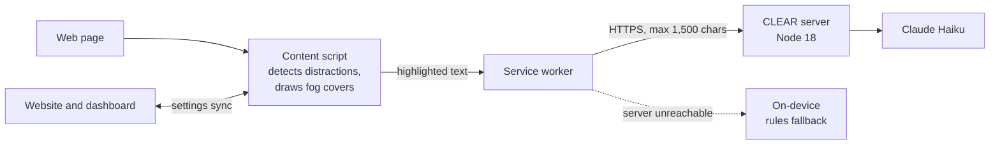

# CLEAR

**Got a problem? Let's CLEAR it up.**

CLEAR is a Chrome extension that makes busy web pages easier to use. It covers ads, GIFs, autoplay video and pop-ups with fog you can wipe away, and it explains any text you highlight in plain language. We built it for people who find the modern web overwhelming: readers with ADHD, autism, sensory sensitivity or dyslexia, and people reading in a second language.

## What it does

| Feature | How it works |
|---|---|
| **Fog covers** | Ads, sponsored posts, GIFs, autoplay video and pop-ups are covered with opaque fog. The page underneath keeps working: menus, search and checkout stay usable. |
| **Wipe to reveal** | Drag across a cover to wipe it clear with a soft brush (mouse, touch or pen). Keyboard users press Tab, then Enter. "Show all" clears everything at once. |
| **Explain with CLEAR** | Highlight text and press Explain (or Alt+Shift+E, or right-click). You get a short plain-language summary and meanings for up to four hard words. A "simpler" level is available. |
| **Your settings** | Three modes (Always covered, Manual reveal, Filtering off), category toggles, color presets, brush size and per-site pause. Settings sync between the website and the extension. |

Videos under a cover are paused and muted. Cookie banners are left uncovered on purpose so you can answer them.

## How it works



- **Detection** is rule-based: ad attributes and class names, known ad-network iframes, "sponsored" labels, dialog roles and fixed positioning. A `MutationObserver` catches content that loads late, and work is split into small time slices so large pages don't freeze.
- **Covers** are `<canvas>` elements painted fully opaque inside a Shadow DOM layer, so a flashing ad can't show through and page styles can't break them.
- **Explanations** come from a small server that holds the API key. The extension and website never see it.

## Repository layout

During the hackathon each of us explored a different part of the problem. All four builds implement the same core idea: calm the page, then explain the text.

| Folder | Build | What it explores | Stack |
|---|---|---|---|
| [`standalone/`](standalone/) | **Demo build** | Fog covers, wipe brush, hardened explanation service, website, Playwright tests | MV3 extension (plain JS), Node 18 server, Claude Haiku, static site |
| [`on-device/`](on-device/) | Fully private AI | Explain and Simplify with no server: Chrome's built-in AI, then small open models running in the browser, then rules. Adds a two-model sarcasm check, GIF freezing and a "Page Forecast" panel. | MV3 extension, Transformers.js, ONNX Runtime (WebAssembly) |
| [`clear-final/`](clear-final/) | Page controls | Section-by-section blur, text size and spacing, layout options, setup wizard; Gemini Nano built into Chrome with cloud fallbacks | MV3 extension, Python Flask + OpenAI |
| [`web-app/`](web-app/) | Onboarding and dashboard | Landing page, onboarding, preferences dashboard, five explanation styles, streaming explain API | TanStack Start, React, Tailwind, Vitest (built with Lovable) |

## Quick start (demo build)

You need Chrome and Node 18 or later.

**1. Load the extension**

1. Open `chrome://extensions` and turn on **Developer mode**.
2. Click **Load unpacked** and choose `standalone/extension`.
3. Open any news site, shop or blog. Covers appear automatically.

Shortcuts: **Alt+Shift+C** turns CLEAR on or off. **Alt+Shift+E** explains the selected text.

**2. Start the explanation server** (needed for Explain with CLEAR)

```bash
cd standalone/backend
ANTHROPIC_API_KEY=sk-ant-... node server.js    # no npm install needed
```

It runs on `http://localhost:8787`, which both config files already use. Check `http://localhost:8787/health`. Without the server, Explain falls back to a simpler on-device mode.

**3. Run the website** (optional)

```bash
cd standalone/website
python3 -m http.server 8080    # open http://localhost:8080
```

Use a local server rather than opening the file directly, because settings sync needs a real origin.

<details>
<summary><b>Running the other builds</b></summary>

- **on-device/**: Load unpacked the `on-device` folder. No server or key. Optional models download once from Hugging Face through the popup (about 270 MB for Simplify, 194 MB for the sarcasm check).
- **clear-final/**: Load unpacked the `clear-final` folder. Chrome's built-in Gemini Nano is used where the computer supports it. For your own backend, run `clear-final/backend/start.sh` (or `start.bat` on Windows) and add an `OPENAI_API_KEY` to `backend/.env`.
- **web-app/**: `cd web-app && bun install && bun run dev`. Explain needs a `LOVABLE_API_KEY`. Its own extension is in `web-app/extension`.

</details>

## Privacy and safety

- **Nothing is collected by default.** Covers are drawn on your computer and settings stay in Chrome storage.
- **Text is sent only when you ask for an explanation.** It is capped at 1,500 characters and never logged or stored.
- **Minimal permissions.** The demo build asks only for `storage` and `contextMenus`.
- **Prompt-injection guard.** Selected text is passed to the model as data, with instructions to ignore any commands inside it. Replies must match a fixed JSON shape.
- **No advice.** For legal, medical or financial text, CLEAR explains what the words say, never what to do.
- **Cost limits.** 15 requests a minute and 200 a day per visitor, a global daily cap, and a CORS allow-list for the website and extension.
- **Fully private option.** The `on-device` build runs its AI in the browser, so text never leaves the computer.

## Tests

`standalone/tests/` holds Playwright scripts that load the real extension in Chromium. They cover end-to-end explain, the wipe brush, data leaks, and performance on a stress page with tens of thousands of elements. They currently expect local paths and a test server on port 8090; see the top of each file. `web-app/` has Vitest tests (`bun run test`).

## Known limits

- Detection is heuristic. It will miss ads with no recognizable markup and may cover the wrong block on unusual sites. "Cover this page now", "Show all" and per-site pause are the escape hatches.
- Cross-origin iframes are covered as a whole. CLEAR can't see inside them, and the audio of a covered YouTube embed keeps playing.
- Content drawn on canvas or WebGL, and CSS background images, aren't detected.
- Tested in Chromium only. Firefox and Safari need manifest changes.
- Not yet tested with screen readers or with users from our target groups. That's our next step.

## Roadmap

1. Test with the people we built for.
2. Merge the four builds: the demo build as the base, plus the on-device AI tier and the web onboarding.
3. Publish to the Chrome Web Store.
4. Improve detection by learning from what people wipe away.

## Team

| | Build |
|---|---|
| [arimahb](https://github.com/arimahb) | Project setup |
| [cami-rsl](https://github.com/cami-rsl) | `standalone/` |
| Kanav Nagpal | `on-device/` |
| [roma-debug](https://github.com/roma-debug) | `clear-final/` |
| Ashley Pu Calderon | `web-app/` |

Built in a weekend, November 14 and 15, 2026.

Third-party code: Transformers.js and ONNX Runtime are bundled in `on-device/vendor/` under their own licenses (see `LICENSE-transformers.txt`).
